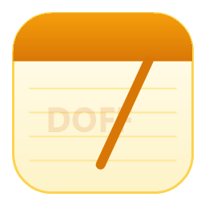

# 📝 Doff Notes

<p align="center">
  
</p>

<p align="center">
  <strong>A native, 100% offline Apple Notes experience crafted for Windows.</strong>
</p>

<p align="center">
  
  
  
  
  
</p>

---

## 📖 Overview

**Doff Notes** brings the clean, minimalist, and distraction-free writing experience of macOS Apple Notes to Windows. 

Designed from the ground up to be **100% offline and local-first**, your notes never touch external servers or third-party clouds. You get an authentic macOS feel — warm parchment sidebar, left-aligned typography, hierarchical subfolder navigation, password-locked encrypted notes, and seamless export to native Apple Notes on macOS.

---

## ✨ Features

### 🎨 Pixel-Perfect Apple Notes Aesthetic
- **Warm Parchment Sidebar**: Clean `#f7f6f1` background with macOS traffic lights (`🔴 🟡 🟢`), folder navigation, and amber active highlights.
- **Left-Aligned Editorial Typography**: Matching Apple Notes' clean left-aligned headers, subtitles, and body text.
- **Collapsible Sidebars & Focus Mode**: Collapse the folder sidebar (`Ctrl+\`) or notes list (`Ctrl+Shift+L`), or enter Apple Notes Focus Mode (`Ctrl+Shift+F`) to write on a clean, centered 860px canvas.
- **Interactive Tag Management**: Type `#tag` in any note or click `+ Tag` at the top bar. Filter notes by tag with one click and clear filters easily.
- **Dual View Modes**: Switch between classic **List View** (`≡`) and visual **Gallery View** (`⊞`).
- **Dark Mode Support**: Seamlessly toggle between Light, Dark, or System mode in Preferences.

### 📂 Hierarchical Subfolders (macOS Tree Style)
- Create nested subfolders to any depth under any folder.
- Smooth caret expand/collapse (`›` / `ˇ`).
- Right-click or use the `...` menu on any folder to create subfolders, rename, or delete.

### 🔒 100% Offline & Private
- No cloud accounts, no sign-ins, no telemetry, and no network dependencies.
- All notes and folders are stored locally on your PC in `%APPDATA%\Doff Notes\notes-database.json`.
- Instant search and millisecond-level responsiveness.

### 🔐 Client-Side AES-256 Encryption
- Lock sensitive notes with a master password.
- Encrypted client-side using industry-standard **AES-GCM 256-bit** with PBKDF2 key derivation.
- Locked notes cannot be read from the raw database file without your password.

### 🍎 Direct Import into Apple Notes on Mac
- Click **Export Notes Folder (for Apple Notes / Mac)** in Preferences.
- Automatically creates a folder hierarchy with every note saved as clean CommonMark `.md` Markdown.
- On macOS, open **Apple Notes** > **File** > **Import to Notes...** to import all your folders and notes directly into iCloud!

### 💻 Single-File Standalone Windows Installer
- `Doff-Notes-Setup.exe` is a **100% self-contained single executable** (~123 MB).
- Double-click once to install permanently to `%LOCALAPPDATA%\Programs\Doff Notes`.
- Automatically adds **Desktop** and **Start Menu** shortcuts with the yellow notepad icon.
- Full uninstaller support in Windows Settings > Installed Apps.

---

## ⌨️ Keyboard Shortcuts

| Shortcut | Action |
| :--- | :--- |
| `Ctrl + N` | Create a New Note |
| `Ctrl + \` | Toggle Folders Sidebar |
| `Ctrl + Shift + L` | Toggle Notes List |
| `Ctrl + Shift + F` | Focus Mode (Distraction-Free Full Canvas) |
| `Escape` | Exit Focus Mode |
| `Ctrl + B` | Bold |
| `Ctrl + I` | Italic |
| `Ctrl + U` | Underline |
| `Ctrl + Shift + 9` | Interactive Checklist |
| `Ctrl + Shift + 7` | Numbered List |
| `Ctrl + Shift + 8` | Bullet List |
| `Ctrl + K` | Insert Link |

---

## 🚀 Download & Installation

### Option 1: Standalone Installer (Recommended)
Download **`Doff-Notes-Setup.exe`** from the [Releases](https://github.com/SkyTripathy/doff-notes/releases) tab.
- Run `Doff-Notes-Setup.exe` once to install.
- Launch Doff Notes from your **Desktop** or **Start Menu**.
- The installer can be kept on a USB drive or deleted after installation.

### Option 2: Portable Mode
If you prefer not to install, you can run the portable executable directly:
```
release\Doff-Notes-win-x64\Doff Notes.exe
```

---

## 🛠️ Tech Stack & Architecture

- **Runtime**: [Electron](https://www.electronjs.org/) (v34)
- **Frontend**: [React 18](https://react.dev/), [TypeScript 5](https://www.typescriptlang.org/)
- **Bundler**: [Vite 6](https://vitejs.dev/), [esbuild](https://esbuild.github.io/)
- **Rich Text Engine**: [TipTap / ProseMirror](https://tiptap.dev/)
- **Styling**: Native macOS CSS Design Tokens & Lucide Icons
- **Installer**: Native .NET Self-Extracting Windows Executable

---

## 🏗️ Building from Source

### Prerequisites
- Node.js 18+ (tested on Node 20 & 24)
- npm or pnpm
- Windows 10 or 11

### 1. Clone & Install Dependencies
```bash
git clone https://github.com/<your-username>/doff-notes.git
cd doff-notes
npm install
```

### 2. Run in Development Mode
```bash
npm run dev
```

### 3. Build Production Binaries
```bash
# Package portable app and compile standalone installer (Doff-Notes-Setup.exe)
npm run package:all
```
The output binaries will be created in the `release/` directory:
- `release/Doff-Notes-Setup.exe` (Self-contained single installer)
- `release/Doff-Notes-win-x64/` (Portable application folder)

---

## 📄 License

This project is licensed under the [MIT License](LICENSE).
